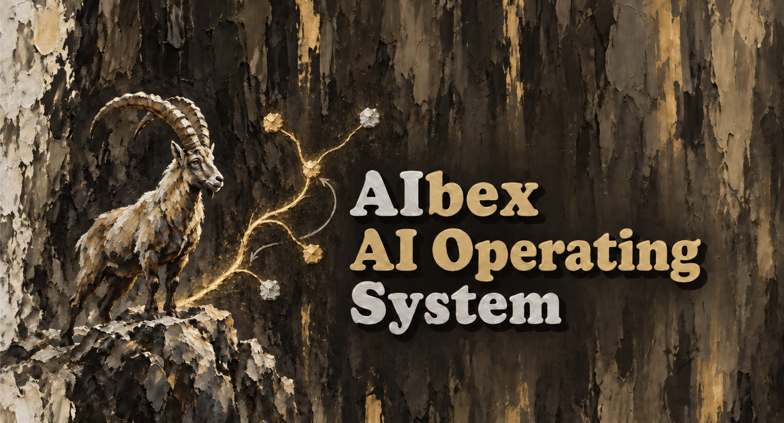

--------------------------------------------------------------------------------

# AIbex AIOS — an Operating System for the Context of AI Assistants

**AIbex AIOS is an operating system for the context of AI assistants.** It
manages which knowledge a chat loads, reads on demand or does not see, and
provides file system conventions, packages, assistants and skills for this
purpose. Execution is left to a host (in v0.5: Claude Code).

AIOS works on an Obsidian vault: every chat runs in a project directory and
receives the knowledge that belongs to this project — no more, no less. An
assistant, assigned to the project, gives every chat there a personality with
its own selection of skills, knowledge and a surface. Skills, assistants,
knowledge and apps come as **packages** from **hubs** (GitHub organizations),
like Python packages from PyPI. Programs that skills call, such as `yt-dlp`,
come as **workhorses**: AIOS sets them up once per version on the machine. A
**distribution** installs a kernel with a tested set of packages in one step.


## Requirements

macOS or Linux with `bash`, `git`, `python3` (3.9 or newer, with the modules
`venv` and `pip`) and [Claude Code](https://claude.com/claude-code) as the host
(`aios --prepare` checks this basic kit). `gh` (GitHub CLI) is needed only to
search hubs without an index and for `aios --contribute` (`aios --prepare --dev`).
Setting up workhorses needs access to PyPI.


## Installation

Copy this line into a terminal:

```sh
R=~/git/AIbex/aibex-aios; ([ -d "$R/.git" ] || git clone https://github.com/aibex-aios/aibex-aios "$R") && "$R/bin/aios" --install v0.5.1
```

It clones the repository to `~/git/AIbex/aibex-aios` unless a clone is already
there (an existing clone is left as it is), then prepares the machine and
installs. The installed files always come from the tag `v0.5.1`, not from the
working tree of the clone; without a version, the highest release tag is
installed.

`aios --install` shows a plan and asks once before it writes anything. It
installs the version read-only to `/opt/aios/v0.5.1/` (without `sudo`:
`~/.aios/versions/`), puts the forwarder `aios` into
`~/bin`, adds two hooks to `~/.claude/settings.json`, the AIOS skills and the
alias `/gui` to `~/.claude/skills/`. Hooks of `ai-brain` are saved and restored by
`aios --uninstall`.

Installing does not touch any vault. A vault runs with AIOS only after it has
been **activated**; all other vaults keep working as before (legacy mode). A
vault of v0.4 (or v0.3) is switched over with `aios --activate v0.5.1 <vault>`:
the plan renames `assistent-gaertner` to `assistant-gaertner`, moves packages
that require v0.4 to their highest version for v0.5 and, from v0.3, turns
`skills:` and `assistants:` into packages. Since v0.5 there is no
`aios-context` any more; its commands are `aios --context …`.

A **distribution** installs the kernel, its workhorses and its packages into a
vault in one plan, e.g. Rothirsch with the video analysis and the assistant Anja:

```sh
aios --install distribution-rothirsch ~/Vaults/§Rothirsch
```


## Quick start

```sh
  mkdir ~/Vaults/§Demo
  aios --activate v0.5.1 ~/Vaults/§Demo      # writes §Demo/.aios/config.yaml, creates §Demo/@/ and a git repo
```

Put knowledge into the **masterspace** `@/` of a project. The prefix of a
folder decides what a chat sees:

| Folder | Class | Effect |
|---|---|---|
| `@Rule/`, `@Wissen/@Content/`, files directly in `@/` | load | loaded at the start of every chat (master context) |
| `@@Kapitel/` | available | not loaded; the master context lists it, the chat reads it on demand |
| `@!Skill/`, `@!Assistant/`, `@!Package/` | hidden | blueprints of skills and assistants, fetched packages |

A project is any folder with `@/` and its own git repo; the vault root is the
root project. A chat in a project sees the masterspaces from the vault root down
to the project. Open a chat in a new folder and AIOS offers to initialize it
(`/aios-init`); at the first start of a chat it checks the structure of the
project and offers to complete it.

Start a chat directly in the project folder. If the host starts it in a git
worktree instead (Claude Code desktop app: `.claude/worktrees/<name>/` on a
branch of its own), results land on that branch and do not appear in the
folder, e.g. in Obsidian, until the branch is merged. AIOS recognizes this at
the start of the chat: Claude says so before the first work and offers the
merge afterwards. This works only for worktrees inside the vault, as the desktop app
creates them by default; a worktree outside the vault is not recognized.

In a chat:

| Skill | Purpose |
|---|---|
| `/aios-gui` | surface of AIOS: all tasks below as tiles, including *Packages* and *Apps* |
| `/aios-package` | packages: search, fetch, deploy, hubs („hol mir den Taschenrechner“) |
| `/aios-fetch`, `/aios-deploy` | fetch a package and register its skills; choose which elements of a package are deployed |
| `/aios-distribution` | compose a distribution from a tested project as a local package repo |
| `/aios-context` | check and show the master context and the assistant |
| `/aios-init` | make the folder a project or complete it (`@/`, git, `.gitignore`, exclusion in the repo above) |
| `/aios-integrity` | check the structure and the commit state of a project and all its subprojects |
| `/aios-register` | register the project skills for Claude Code |
| `/aios-assistant Gärtner` | assign an assistant to the project (`--none`, `--inherit`) and switch to it |
| `/gui` | surface of the assistant of the session |
| `/aios-memo` | memo style in every project (only when no skill `memo` is available) |
| `/aios-status` | project status from memos and git |

Registered skills become available in the **next** chat. The assistant is a
property of the project: `assistant: <name>`, `none` or `inherit` (the default)
in `.aios/config.yaml`. New chats load it automatically; compaction and resume
keep the assistant a chat started with.


## Packages and hubs

A **package** is a git repo with a `manifest.yaml` (name, version, type,
dependencies, contents) and version tags `v<x.y.z>`. Its name says its type:
`skill-memo`, `assistant-gaertner`, `knowledge-orion`, `app-taschenrechner`,
`worker-yt-dlp`, `distribution-rothirsch`.
A **hub** is a place for packages, a GitHub organization or any git server;
the **hub list** (`hubs:` in `~/.aios/config.yaml` and at the vault root)
says where AIOS looks, by default `aibex-aios`.

```sh
  aios --library rechner                       # search the hubs of the hub list
  aios --fetch app-taschenrechner              # fetch, deploy and register (with dependencies)
  aios --fetch                                 # sync the project with .aios/lock.yaml
  aios --fetch --upgrade                       # choose the highest versions anew
  aios --hubs add aibex-hub --vault            # a second hub for the vault
  aios --worker                                # workhorses on the machine and who uses them
```

`aios --fetch` copies the package without `.git` to `@/@!Package/<name>/`,
writes the requested range to `packages:` in `.aios/config.yaml` and the
resolved versions and commits to `.aios/lock.yaml`. Every project is complete
in itself. Every plan of `aios --fetch` backs up what it changes and restores it
if a step fails (all or nothing). The packages of the hub `aibex-aios`:

| Package | Type | Content |
|---|---|---|
| `app-taschenrechner` | app | programmable RPN calculator like the HP-15C, function keys A–D with *LEARN* (`/taschenrechner-gui`) |
| `assistant-gaertner` | assistant | Gärtner, calculates only with apples and pears, starts every answer with 👩‍🌾; surface with an apple-pear calculator |
| `assistant-astronom` | assistant | Astronom, calculates only with sun and moon, starts every answer with 💫, looks up star data |
| `assistant-anja` | assistant | Anja, specialist for developing AIOS packages of all types |
| `knowledge-orion` | knowledge | the brightest stars of Orion (SIMBAD, Wikipedia) |
| `skill-memo` | skill | memo style for projects in AIOS vaults |
| `skill-5-8-zusammenfassung` | skill | 5-8 summary of a document as a memo |
| `skill-video-analyse` | skill | transcript and 5-8 summary of a YouTube video, with `worker-yt-dlp` |
| `worker-yt-dlp`, `worker-deno` | worker | the programs `yt-dlp` and `deno`, set up from PyPI with hashes |
| `distribution-rothirsch` | distribution | kernel 0.5.0 with the video analysis and Anja |

The hub `aibex-hub` holds `knowledge-scorpio` (the brightest stars of
Scorpius). Each demo assistant politely refuses the other one's calculations,
so the answer shows which assistant and which skill are active.

**Workspaces** clone several repos as projects of one root project, from
`.aios/workspace.yaml` (`aios --workspace init | update | freeze | status`).
**Contributions** go back to a package as a pull request
(`aios --contribute <file> --to <package>`).


## Tutorials

The tutorials (German) walk through a demo vault:

- [`01 Erste Schritte mit den Demo-Assistenten`](doc/tutorials/01%20Erste%20Schritte%20mit%20den%20Demo-Assistenten.md) — vault, projects, chain, assistants as packages
- [`02 Projekte und Integrität`](doc/tutorials/02%20Projekte%20und%20Integrit%C3%A4t.md) — subprojects, consistency check, `/aios-integrity`
- [`03 Pakete und Taschenrechner`](doc/tutorials/03%20Pakete%20und%20Taschenrechner.md) — hubs, fetch, deploy, the calculator, contribute
- [`04 Workspaces`](doc/tutorials/04%20Workspaces.md) — `workspace.yaml`, `init`, `update`, `freeze`, `status`
- [`05 Arbeitspferde und Distributionen`](doc/tutorials/05%20Arbeitspferde%20und%20Distributionen.md) — Rothirsch, workhorses, forwarders, a second machine


## Command line

| Command | Purpose |
|---|---|
| `aios --prepare [--dev]`, `--install [v<version>]`, `--versions`, `--remove-version v<version>`, `--uninstall` | basic kit and installations |
| `aios --install distribution-<name> [<vault>] [--from <repo>]` | install or upgrade a distribution: kernel, workhorses, packages |
| `aios --activate v<version> [<path>]`, `--deactivate [<path>]`, `--config [<path>]` | bind a vault or project to a version, show the configuration |
| `aios --init`, `--integrity`, `--register` | projects and their skills |
| `aios --library`, `--hubs`, `--fetch`, `--deploy` | packages: search, hub list, fetch, deployed elements |
| `aios --worker [<package> setup]`, `--run`, `--contribute`, `--workspace` | workhorses (state, repair), commands of packages, contributions, workspaces |
| `aios --assistant <name\|none\|inherit> [--to <project>]`, `--gui [--html] [--aios] [--apps]` | assignment of the assistant, surfaces |
| `aios --context [<path>]`, `--load`, `--id`, `--list`, `--assistant <name> [--load]`, `--assistants`, `--assignment` | master context and assistants |

`aios --help` lists all options. Every writing command shows a plan first;
`--plan` only shows it, `--yes` skips the question and prints only the result.
Several versions can be installed side by side; each vault or project chooses
its version with `aios: <version>` in `.aios/config.yaml`.


## Documentation

The specification of each version is part of it: `spec/` in this repository,
installed to `/opt/aios/v<version>/doc/spec/`; tutorials are installed from
`doc/tutorials/` to `/opt/aios/v<version>/doc/tutorials/`.

| Spec | Content |
|---|---|
| `01 AIbex AIOS v0.5 — Überblick` | definition, terms, scope, pre-releases, invariants, acceptance test |
| `02 Master-Kontext` | projects, chain, classes, `aios --context`, hooks, assistant of the session, consistency check |
| `03 Skills und Assistenten` | skills, versions, registry, assistants and their assignment, GUIs, `aios-package`, `aios-distribution`, `aios-memo` |
| `04 Installation und Konfiguration` | files, formats, forwarders, the command `aios` |
| `05 Projekte` | project structure and naming, init, integrity, status |
| `06 Pakete und Workspaces` | packages, manifest, versions, hubs, fetch, deploy, distributions, lock, workspaces, contribute, the calculator |
| `07 Arbeitspferde` | workhorses (`worker-<name>`), installation per version, forwarders, setup and remove |


## Development

```sh
  tests/run                  # all tests in a sandbox with local test hubs, never touch the machine
  tests/hub/build <dir>      # build the test hubs from tests/hub/ and print AIOS_HUBS
  tests/live/hooks.sh        # real headless Claude sessions (cost tokens)
  tests/live/skills.sh
  tests/live/assistants.sh
  tests/live/workers.sh      # worker-deno, worker-yt-dlp against the real PyPI
  tests/live/rothirsch.sh    # distribution Rothirsch in a sandbox (PyPI)
  dev/doc-outputs.sh         # outputs of README and tutorials from a sandbox of the package repos
```

A clone can be used without installing: point `AIOS_HOME` to it, or add a
line `v0.5.2-dev: ~/git/AIbex/aibex-aios` to `~/.aios/installations.yaml`.
`AIOS_HUBS` and `AIOS_GITHUB` redirect hubs for tests (spec 04).
`CLAUDE.md` holds the rules for working on the repository, `STATUS.md` the
state of the implementation.


## Status

Version **0.5.1** (`STATUS.md`): workhorses and loading packages — programs
like `yt-dlp` as packages of type `worker`, set up once per version on the
machine and chosen by `lock.yaml` through forwarders in `~/.aios/bin/`; every
plan of `aios --fetch` is all or nothing; distributions install a kernel with
its packages (`aios --install distribution-<name>`, `/aios-distribution`);
`aios --context` replaces `aios-context`; the assistant packages are named `assistant-*`.
0.5.1 recognizes worktrees of the host, installs a distribution on a fresh machine
without PyYAML and fixes findings of the acceptance of 0.5.0.
Versions 0.1.0, 0.2.0, 0.3.1, 0.4.0 and 0.5.0 are released (tags `v0.1.0`, `v0.2.0`,
`v0.3.1`, `v0.4.0`, `v0.5.0`). All versions below 1.0 are alpha and beta versions.
